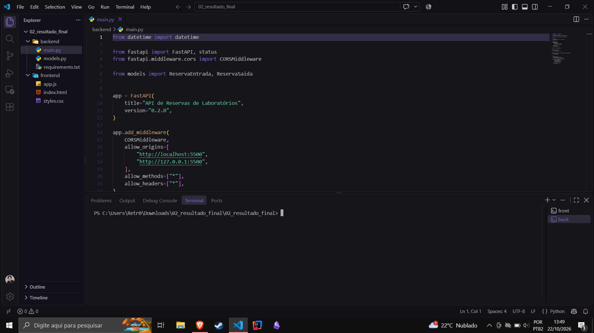
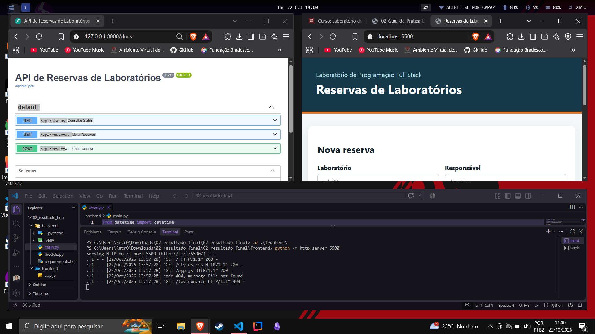
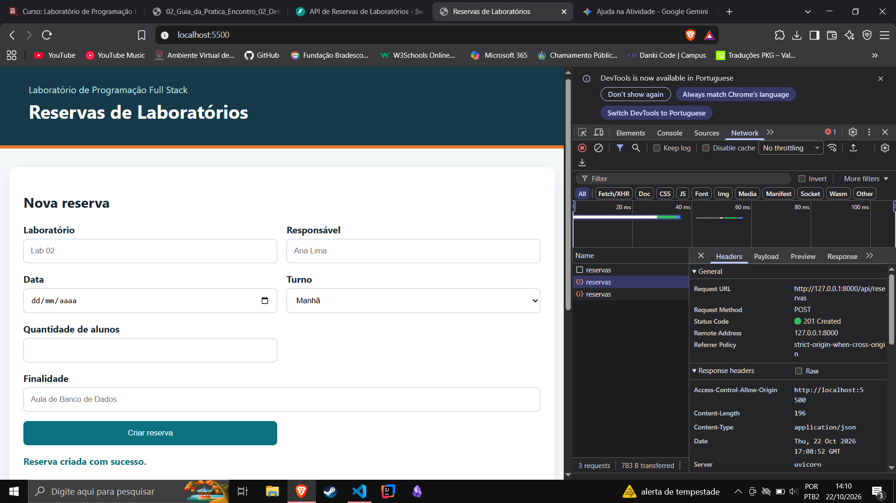
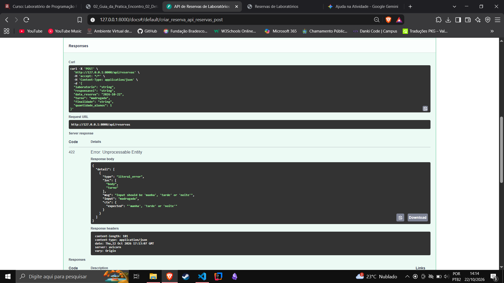

# Sistema de Reservas de Laboratórios - Encontro 02

**Aluno:** Samuel Ribeiro Soares
**Atividade:** Laboratório de Programação Full Stack - Encontro 2

## 1. Contrato Preliminar da API (POST /api/reservas)
O contrato que define como cliente e servidor conversam nesta rota:
* **URL-base:** `http://127.0.0.1:8000`
* **Rota e Método:** `POST /api/reservas` (para criar uma nova reserva)
* **Corpo (Payload):** JSON com os dados da reserva (laboratorio, responsavel, data_reserva, turno, quantidade_alunos, finalidade)
* **Respostas Esperadas:** 
  * `201 Created` para sucesso
  * `422 Unprocessable Content` para falha de contrato/validação

## 2. Evidências Visuais
*Lembrete: Certifique-se de que as imagens na pasta `img` não tenham espaços no nome.*

* **Evidência A (Árvore do projeto e terminais):** 
  
* **Evidência B (Interface e Swagger rodando):** 
  
* **Evidência C (Sucesso 201):** 
  
* **Evidência C (Erro 422):** 
  

## 3. Alterações Realizadas (Parte D)
Tabela detalhando os arquivos alterados para a implementação do campo `quantidade_alunos`:

| Arquivo alterado | Responsabilidade da mudança |
| :--- | :--- |
| `frontend/index.html` | Adição do campo numérico (`min="1" max="40"`) no formulário HTML. |
| `frontend/app.js` (Envio) | Captura do valor do input, conversão para número (`Number`) e inclusão no objeto `dados` enviado no Payload. |
| `backend/models.py` | Atualização do modelo Pydantic `ReservaEntrada` para validar o campo no back-end exigindo valores entre 1 e 40 (`ge=1, le=40`). |
| `frontend/app.js` (Cartão) | Interpolação da variável (`${reserva.quantidade_alunos}`) na interface para exibir o dado após a criação. |

## 4. Perguntas de Verificação

**5. Por que a validação HTML não substitui o Pydantic?**
Porque a validação HTML atua apenas no navegador do usuário. O Pydantic valida os dados no back-end, garantindo que o servidor não aceite dados em formatos inválidos ou maliciosos de fontes externas.

**6. Por que JSON.stringify é necessário?**
O JavaScript cria um objeto em memória, mas para trafegar esse objeto no corpo de uma requisição HTTP, ele precisa ser convertido em texto JSON.

**7. Onde o código 201 é definido?**
Ele é definido na rota `POST /api/reservas` no back-end (FastAPI), indicando que um novo recurso (a reserva) foi criado com sucesso.

**8. O que acontece se o JavaScript enviar quantidade Alunos?**
A API retornará um erro `422 Unprocessable Content`, pois os nomes enviados no front-end devem coincidir exatamente com os campos definidos no modelo do Pydantic (`quantidade_alunos`).

**9. Como provar que a requisição alcançou o servidor?**
Observando os logs impressos no terminal do Uvicorn, que registra todas as requisições que chegam ao back-end.